# Pipeline Blackboard: oneRole_pipeline

## Pipeline Flow

```mermaid
graph TD
    start["Pipeline Started"]
    subgraph "Sync Architecture Stage"
        sync_root["sync_architecture Stage Started"]
        sync_root --> w_sync1["worker_d6056e4b<br/>Implemented logging of job sync counts per company in the SourceSyncEventHandler."]
        sync_root --> w_sync2["worker_e8c6549f<br/>Dispatched"]
        sync_root --> w_sync3["worker_d9f0041d<br/>Dispatched"]
        sync_root --> w_sync4["worker_17f8d15c<br/>Dispatched"]

        w_sync1 --> synth_sync["Synthesis (sync_architecture)<br/>stage_artifact_sync_architecture_oneRole_pipeline.md"]
        w_sync2 --> synth_sync
        w_sync3 --> synth_sync
        w_sync4 --> synth_sync
    end

    subgraph "Submission Agent Stage"
        sub_root["submission_agent Stage Started"]
        sub_root --> w_sub1["worker_db451909<br/>Implemented watchdog mechanism to detect and reclaim stuck 'in_flight' applications."]
        sub_root --> w_sub2["worker_b29c6369<br/>Implemented ApplicationStuck status in models/application.go and updated service/auto_apply_engine.go to transition applications to this state for persistent, non-transient, and non-captcha submission errors, facilitating further analysis of 'stuck' scenarios."]
        sub_root --> w_sub9["worker_9f172f70<br/>Optimized stuck application reclamation by introducing batching to prevent overwhelming the database and system when handling large volumes (100k+) of stuck applications."]
        sub_root --> w_sub3["worker_4579a914<br/>Implemented SubmissionContext and basic stuck detection/logging in browser_submitter.js. Introduced a new submitApplication wrapper that uses SubmissionContext to log steps and handle navigation timeouts."]
        sub_root --> w_sub4["worker_3c14784f<br/>Added stuck source detection to the repository and created a CLI tool (cmd/report_stuck) to identify degraded/paused sources for intervention."]
        sub_root --> w_sub5["worker_cc74e901<br/>Implemented searchGeneralizedSolution and fetchKnowledgeBaseSolution in service/auto_apply_engine.go to detect and handle stuck applications using a mocked TSenta knowledge base lookup."]
        sub_root --> w_sub6["worker_80233151<br/>Improved stuck application handling by transitioning them to requires_manual_action status instead of failed_retryable, and added a diagnostic search event to the audit log for better traceability."]
        sub_root --> w_sub7["worker_b2d63ec8<br/>Dispatched"]
        sub_root --> w_sub8["worker_934895a0<br/>Dispatched"]
        sub_root --> w_sub10["worker_174065cf<br/>Implemented application validation to improve submission accuracy and efficiency."]
        sub_root --> w_sub11["worker_0910f0e8<br/>Restructured stuck application resolution workflow in service/auto_apply_engine.go to fetch metadata and automatically re-queue applications upon resolution."]

        w_sub1 --> synth_sub["Synthesis (submission_agent)<br/>stage_artifact_submission_agent_oneRole_pipeline.md"]
        w_sub2 --> synth_sub
        w_sub9 --> synth_sub
        w_sub3 --> synth_sub
        w_sub4 --> synth_sub
        w_sub5 --> synth_sub
        w_sub6 --> synth_sub
        w_sub7 --> synth_sub
        w_sub8 --> synth_sub
        w_sub10 --> synth_sub
        w_sub11 --> synth_sub
    end

    subgraph "UI Alignment Stage"
        ui_root["ui_alignment Stage Started"]
        ui_root --> w_ui1["worker_7b5985c8<br/>UI Alignment: Updated MatchCard, added 'Assist' action to ApplicationTracker, improved status indicator and table observability."]
        ui_root --> w_ui2["worker_85f1f179<br/>Analyzed TSenta UI, implemented transparent diff preview in JobDetailModal, and added status dashboard in AutoApplyView to align OneRole UI with TSenta-like transparency and data density."]
        ui_root --> w_ui3["worker_95d0b60c<br/>Added btn-card-apply class to MatchCard.jsx for test compatibility."]
        ui_root --> w_ui4["worker_5f717ef6<br/>Implemented consistent focus states for improved accessibility across the Navbar and MatchCard components, and documented missing UI/UX items compared to the TSenta design principles in the output file."]
        ui_root --> w_ui5["worker_3d8502fd<br/>Dispatched"]
        ui_root --> w_ui6["worker_54ab38a5<br/>Enhanced ATS scoring engine to provide transparency into matched skills."]
        ui_root --> w_ui7["worker_def4d70c<br/>Implemented FormError component and updated AddRoleModal to use it."]
        ui_root --> w_ui8["worker_ce826601<br/>Implemented explicit form error handling in AddRoleModal, improved sidebar contrast, and standardized animation transitions using CSS variables."]
        ui_root --> w_ui9["worker_838a7952<br/>❌ Failed"]
        ui_root --> w_ui10["worker_b898500d<br/>Improved FilterBar accessibility by adding consistent focus states to dropdown buttons and consolidating CSS definitions in styles.css."]
        ui_root --> w_ui11["worker_0e038839<br/>Created a reusable EmptyState component to standardize UI for empty states and applied it to ApplicationTracker and JobCatalogGrid."]
        ui_root --> w_ui12["worker_2210336d<br/>Standardized UI by adding design system variables for error states and refactoring AddRoleModal, FormError, and FormFieldError to use CSS variables for consistent theming and accessibility."]
        ui_root --> w_ui13["worker_52fb04ad<br/>Dispatched"]
        ui_root --> w_ui14["worker_239c0d26<br/>Dispatched"]
    end

    start --> sync_root
    synth_sync --> sub_root
    synth_sub --> ui_root
```

## Stage Summary

Stage | Status | Workers | Synthesis
----- | ------ | ------- | ---------
sync_architecture | ✅ Complete | 4 (1 ✅, 3 ⏳) | ✅ stage_artifact_sync_architecture_oneRole_pipeline.md
submission_agent | ✅ Complete | 11 (11 ✅) | ✅ stage_artifact_submission_agent_oneRole_pipeline.md
ui_alignment | ⏳ Running | 14 (11 ✅, 1 ❌, 2 ⏳) | ⚠️ Pending Synthesis Summary
