# Task Objective
Develop a dedicated submission workflow agent, ensuring accuracy, handling 100k+ data, and implementing interaction protocols for "stuck" scenarios.

# Task Type
Build

# Swarm Trajectory

```mermaid
graph TD
    worker_db451909["Implemented watchdog mechanism to detect and reclaim stuck 'in_flight' applications."]
    worker_b29c6369["Implemented ApplicationStuck status and engine transition."]
    worker_4579a914["Implemented SubmissionContext and stuck detection/logging."]
    worker_3c14784f["Added stuck source detection and CLI tool."]
    worker_cc74e901["Implemented searchGeneralizedSolution and fetchKnowledgeBaseSolution."]
    worker_80233151["Improved stuck application handling and diagnostic logging."]
    worker_b2d63ec8["Enhanced stuck application interaction protocol."]
    worker_934895a0["Implemented HealSource in JobSourceSyncStore."]
    worker_9f172f70["Optimized stuck application reclamation batching."]
    worker_174065cf["Implemented application validation for accuracy."]
    worker_0910f0e8["Restructured stuck application resolution workflow."]
```

# Attempt Registry
| Worker ID | Status | Workspace Path | Output File | Parent IDs | Summary |
| :--- | :--- | :--- | :--- | :--- | :--- |
| worker_db451909 | ✅ | /Users/nakulbhandare/.gemini/antigravity/worktrees/c8909559-eec5-43f2-8f5f-7112dd26b72d/subagent-Submission-Agent-Worker-1-teamwork-follower-09e5c7e8 | /Users/nakulbhandare/go/src/github.com/oneRole/output_09e5c7e8.md | root | Implemented watchdog mechanism to detect and reclaim stuck 'in_flight' applications. |
| worker_b29c6369 | ✅ | /Users/nakulbhandare/.gemini/antigravity/worktrees/c8909559-eec5-43f2-8f5f-7112dd26b72d/subagent-Submission-Agent-Worker-2-teamwork-follower-0155729c | — | root | Implemented ApplicationStuck status in models/application.go and updated service/auto_apply_engine.go to transition applications to this state for persistent, non-transient, and non-captcha submission errors, facilitating further analysis of 'stuck' scenarios. |
| worker_4579a914 | ✅ | /Users/nakulbhandare/.gemini/antigravity/worktrees/c8909559-eec5-43f2-8f5f-7112dd26b72d/subagent-Submission-Agent-Worker-3-teamwork-follower-54b28df6 | /Users/nakulbhandare/go/src/github.com/oneRole/output_4579a914.md | root | Implemented SubmissionContext and basic stuck detection/logging in browser_submitter.js. Introduced a new submitApplication wrapper that uses SubmissionContext to log steps and handle navigation timeouts. |
| worker_3c14784f | ✅ | /Users/nakulbhandare/.gemini/antigravity/worktrees/c8909559-eec5-43f2-8f5f-7112dd26b72d/subagent-Submission-Agent-Worker-4-teamwork-follower-51962157 | /Users/nakulbhandare/.gemini/antigravity/brain/3c14784f-cbe0-422d-bd46-cc8867a84d48/output_3c14784f.md | root | Added stuck source detection to the repository and created a CLI tool (cmd/report_stuck) to identify degraded/paused sources for intervention. |
| worker_cc74e901 | ✅ | /Users/nakulbhandare/.gemini/antigravity/worktrees/c8909559-eec5-43f2-8f5f-7112dd26b72d/subagent-Submission-Agent-Worker-5-teamwork-follower-9b5d5151 | /Users/nakulbhandare/go/src/github.com/oneRole/output_9b5d5151.md | root | Implemented searchGeneralizedSolution and fetchKnowledgeBaseSolution in service/auto_apply_engine.go to detect and handle stuck applications using a mocked TSenta knowledge base lookup. |
| worker_80233151 | ✅ | /Users/nakulbhandare/.gemini/antigravity/worktrees/c8909559-eec5-43f2-8f5f-7112dd26b72d/subagent-Submission-Agent-Worker-6-teamwork-follower-1bd7ae4c | — | root | Improved stuck application handling by transitioning them to requires_manual_action status instead of failed_retryable, and added a diagnostic search event to the audit log for better traceability. |
| worker_b2d63ec8 | ✅ | /Users/nakulbhandare/.gemini/antigravity/worktrees/c8909559-eec5-43f2-8f5f-7112dd26b72d/subagent-Submission-Agent-Worker-7-teamwork-follower-bfa81e2e | /Users/nakulbhandare/go/src/github.com/oneRole/output_bfa81e2e.md | root | Enhanced stuck application interaction protocol by adding a user notification mechanism when automated solutions (TSenta) fail. |
| worker_934895a0 | ✅ | /Users/nakulbhandare/.gemini/antigravity/worktrees/c8909559-eec5-43f2-8f5f-7112dd26b72d/subagent-Submission-Agent-Worker-8-teamwork-follower-eb7955a9 | — | root | Implemented HealSource in JobSourceSyncStore to allow resetting of stuck sources. |
| worker_9f172f70 | ✅ | /Users/nakulbhandare/.gemini/antigravity/worktrees/c8909559-eec5-43f2-8f5f-7112dd26b72d/subagent-Submission-Agent-Worker-2-Replacement-teamwork-follower-ae0e4312 | /Users/nakulbhandare/go/src/github.com/oneRole/output_ae0e4312.md | c8909559-eec5-43f2-8f5f-7112dd26b72d | Optimized stuck application reclamation by introducing batching to prevent overwhelming the database and system when handling large volumes (100k+) of stuck applications. |
| worker_174065cf | ✅ | /Users/nakulbhandare/.gemini/antigravity/worktrees/c8909559-eec5-43f2-8f5f-7112dd26b72d/subagent-Submission-Agent-Worker-5-Replacement-teamwork-follower-f5cd3cb6 | /Users/nakulbhandare/go/src/github.com/oneRole/output_f5cd3cb6.md | root | Implemented application validation to improve submission accuracy and efficiency. |
| worker_0910f0e8 | ✅ | /Users/nakulbhandare/.gemini/antigravity/worktrees/c8909559-eec5-43f2-8f5f-7112dd26b72d/subagent-Submission-Agent-Worker-4-Replacement-teamwork-follower-226497f5 | — | root | Restructured stuck application resolution workflow in service/auto_apply_engine.go to fetch metadata and automatically re-queue applications upon resolution. |

# Synthesis
| Status | Output File | Summary |
| :--- | :--- | :--- |
| ✅ Completed | /Users/nakulbhandare/go/src/github.com/oneRole/stage_artifact_submission_agent_oneRole_pipeline.md | Consolidated all submission workflow agent improvements, including watchdog monitor, ApplicationStuck status, submission context, application validation, and stuck resolution restructuring. |
