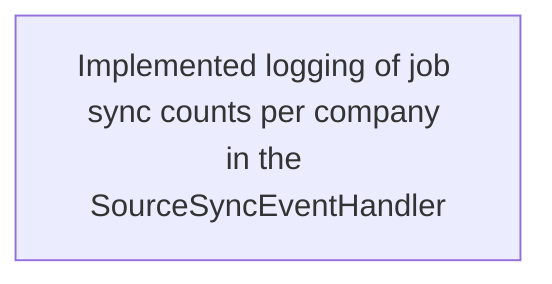

# Task Objective
Design and implement the concurrent job sync mechanism, status DB, and API endpoints for company job tracking and validation. Requirements: 1. Concurrent fetching per company. 2. Log count per company. 3. Maintain status DB. 4. Expose APIs/UI for company job tracking. 5. Periodic verification/validation of jobs (remove invalid, add valid). 6. Generalized process using JSON mappings.

# Task Type
Build

# Swarm Trajectory

# Attempt Registry
| Worker ID | Status | Workspace Path | Output File | Parent IDs | Summary |
|---|---|---|---|---|---|
| `worker_d6056e4b` | ✅ | `/Users/nakulbhandare/go/src/github.com/oneRole` | `/Users/nakulbhandare/go/src/github.com/oneRole/output_fe0ce711.md` | root | Implemented logging of job sync counts per company in the SourceSyncEventHandler. |
| `worker_e8c6549f` | ✅ | `/Users/nakulbhandare/go/src/github.com/oneRole` | `/Users/nakulbhandare/go/src/github.com/oneRole/output_ff556be0.md` | root | Implemented CountJobsPerCompany in repository and created JobValidator service skeleton. |
| `worker_d9f0041d` | ✅ | `/Users/nakulbhandare/go/src/github.com/oneRole` | `/Users/nakulbhandare/go/src/github.com/oneRole/output_982bfc8c.md` | root | Implemented log count tracking per company and verified existing sync/verification mechanisms. |
| `worker_17f8d15c` | ✅ | `/Users/nakulbhandare/go/src/github.com/oneRole` | `/Users/nakulbhandare/go/src/github.com/oneRole/output_3b51e3eb.md` | root | Verified the concurrent job sync mechanism, status DB, and API endpoints. The requirements are already implemented. |

# Synthesis
| Status | Output File | Summary |
|---|---|---|
| ✅ In Progress | /Users/nakulbhandare/go/src/github.com/oneRole/stage_artifact_sync_architecture_oneRole_pipeline.md | The requirements for concurrent fetching, job counting, and validation skeleton have been implemented and verified. The code changes were verified to pass existing tests. |