# Blackboard: UI Alignment

## Task Objective
Analyze TSenta UI, replicate its components/styling exactly, test edge cases, and align OneRole UI accordingly. Provide a list of missing/improvement items compared to TSenta and implement them.

## Task Type
Build

## Swarm Trajectory

```mermaid
graph TD
root --> worker_95d0b60c["Added btn-card-apply class to MatchCard.jsx for test compatibility."]
root --> worker_85f1f179["Implemented transparent diff preview in JobDetailModal, and added status dashboard in AutoApplyView."]
root --> worker_7b5985c8["UI Alignment: Updated MatchCard, added 'Assist' action to ApplicationTracker, improved status indicator and table observability."]
root --> worker_5f717ef6["Implemented consistent focus states for accessibility, and documented missing UI/UX items."]
root --> worker_3d8502fd["Added 'View' button to MatchCard for improved human-in-the-loop review."]
root --> worker_54ab38a5["Enhanced ATS scoring engine to provide transparency into matched skills."]
root --> worker_def4d70c["Implemented FormError component and updated AddRoleModal to use it."]
root --> worker_ce826601["Implemented explicit form error handling in AddRoleModal, improved sidebar contrast, and standardized animation transitions."]
root --> worker_b898500d["Improved FilterBar accessibility by adding consistent focus states to dropdown buttons and consolidating CSS definitions."]
root --> worker_0e038839["Created a reusable EmptyState component to standardize UI for empty states and applied it to ApplicationTracker and JobCatalogGrid."]
worker_def4d70c --> worker_2210336d["Standardized UI by adding design system variables for error states and refactoring components."]
root --> worker_00080b40["Improved FilterBar UI/UX by adding a loading state and disabling inputs during job reloading."]
root --> worker_52fb04ad["Refactored ApplicationTracker and Navbar to align with the established CSS design system."]
root --> worker_239c0d26["Refactored MatchCard.jsx to align theme colors and button styling with TSenta design principles."]
```

## Attempt Registry
| Worker ID | Status | Workspace Path | Output File | Parent IDs | Summary |
| --- | --- | --- | --- | --- | --- |
| worker_7b5985c8 | ✅ | /Users/nakulbhandare/.gemini/antigravity/worktrees/ddec90e7-c25f-4d0d-9342-a1373cc9f137/subagent-UI-Alignment-Worker-1-teamwork-follower-9066289f | — | root | UI Alignment: Updated MatchCard, added 'Assist' action to ApplicationTracker, improved status indicator and table observability. |
| worker_85f1f179 | ✅ | /Users/nakulbhandare/go/src/github.com/oneRole | /Users/nakulbhandare/go/src/github.com/oneRole/output_85f1f179.md | root | Analyzed TSenta UI, implemented transparent diff preview in JobDetailModal, and added status dashboard in AutoApplyView to align OneRole UI with TSenta-like transparency and data density. |
| worker_95d0b60c | ✅ | /Users/nakulbhandare/.gemini/antigravity/worktrees/ddec90e7-c25f-4d0d-9342-a1373cc9f137/subagent-UI-Alignment-Worker-3-teamwork-follower-7a56c923 | /Users/nakulbhandare/.gemini/antigravity/worktrees/ddec90e7-c25f-4d0d-9342-a1373cc9f137/subagent-UI-Alignment-Worker-3-teamwork-follower-7a56c923/output_7a56c923.md | root | Added btn-card-apply class to MatchCard.jsx for test compatibility. |
| worker_5f717ef6 | ✅ | /Users/nakulbhandare/.gemini/antigravity/worktrees/ddec90e7-c25f-4d0d-9342-a1373cc9f137/subagent-UI-Alignment-Worker-4-teamwork-follower-3722bbbb | /Users/nakulbhandare/go/src/github.com/oneRole/output_3722bbbb.md | root | Implemented consistent focus states for improved accessibility across the Navbar and MatchCard components, and documented missing UI/UX items compared to the TSenta design principles in the output file. |
| worker_3d8502fd | ✅ | /Users/nakulbhandare/go/src/github.com/oneRole | /Users/nakulbhandare/go/src/github.com/oneRole/output_4104df37.md | root | Added 'View' button to MatchCard for improved human-in-the-loop review. |
| worker_54ab38a5 | ✅ | /Users/nakulbhandare/.gemini/antigravity/worktrees/ddec90e7-c25f-4d0d-9342-a1373cc9f137/subagent-UI-Alignment-Worker-6-teamwork-follower-ae81ca0a | /Users/nakulbhandare/.gemini/antigravity/worktrees/ddec90e7-c25f-4d0d-9342-a1373cc9f137/subagent-UI-Alignment-Worker-6-teamwork-follower-ae81ca0a/output_ae81ca0a.md | root | Enhanced ATS scoring engine to provide transparency into matched skills. |
| worker_def4d70c | ✅ | /Users/nakulbhandare/go/src/github.com/oneRole | /Users/nakulbhandare/go/src/github.com/oneRole/output_9e23c158.md | root | Implemented FormError component and updated AddRoleModal to use it. |
| worker_ce826601 | ✅ | /Users/nakulbhandare/go/src/github.com/oneRole | /Users/nakulbhandare/go/src/github.com/oneRole/output_3d8502fd.md | root | Implemented explicit form error handling in AddRoleModal, improved sidebar contrast, and standardized animation transitions using CSS variables. |
| worker_838a7952 | ❌ | /Users/nakulbhandare/.gemini/antigravity/worktrees/ddec90e7-c25f-4d0d-9342-a1373cc9f137/subagent-UI-Alignment-Worker-9-teamwork-follower-01e9ca92 | — | root | Worker failed during initialization. |
| worker_b898500d | ✅ | /Users/nakulbhandare/.gemini/antigravity/worktrees/ddec90e7-c25f-4d0d-9342-a1373cc9f137/subagent-UI-Alignment-Worker-10-teamwork-follower-b7d42ff4 | /Users/nakulbhandare/go/src/github.com/oneRole/output_b7d42ff4.md | root | Improved FilterBar accessibility by adding consistent focus states to dropdown buttons and consolidating CSS definitions in styles.css. |
| worker_0e038839 | ✅ | /Users/nakulbhandare/.gemini/antigravity/worktrees/ddec90e7-c25f-4d0d-9342-a1373cc9f137/subagent-UI-Alignment-Worker-11-teamwork-follower-ab85f72a | /Users/nakulbhandare/go/src/github.com/oneRole/output_ab85f72a.md | root | Created a reusable EmptyState component to standardize UI for empty states and applied it to ApplicationTracker and JobCatalogGrid. |
| worker_2210336d | ✅ | /Users/nakulbhandare/go/src/github.com/oneRole | /Users/nakulbhandare/go/src/github.com/oneRole/output_c6c36475.md | def4d70c | Standardized UI by adding design system variables for error states and refactoring AddRoleModal, FormError, and FormFieldError to use CSS variables for consistent theming and accessibility. |
| worker_00080b40 | ✅ | /Users/nakulbhandare/.gemini/antigravity/worktrees/ddec90e7-c25f-4d0d-9342-a1373cc9f137/subagent-UI-Alignment-Worker-13-teamwork-follower-9ab1a120 | /Users/nakulbhandare/go/src/github.com/oneRole/output_9ab1a120.md | root | Improved FilterBar UI/UX by adding a loading state and disabling inputs during job reloading to provide better visual feedback and prevent redundant requests. |
| worker_52fb04ad | ✅ | /Users/nakulbhandare/.gemini/antigravity/worktrees/ddec90e7-c25f-4d0d-9342-a1373cc9f137/subagent-UI-Alignment-Worker-14-teamwork-follower-dc38171a | /Users/nakulbhandare/.gemini/antigravity/brain/52fb04ad-d386-4319-8fc3-26583da9c02f/output_dc38171a.md | root | Refactored ApplicationTracker and Navbar to align with the established CSS design system, improving maintainability and UI consistency. |
| worker_239c0d26 | ✅ | /Users/nakulbhandare/go/src/github.com/oneRole | /Users/nakulbhandare/go/src/github.com/oneRole/output_0a55bbda.md | root | Refactored MatchCard.jsx to align theme colors and button styling with TSenta design principles, while retaining btn-card-apply for test compatibility. |

## Synthesis
| Status | Output File | Summary |
| --- | --- | --- |
| ✅ Completed | /Users/nakulbhandare/go/src/github.com/oneRole/stage_artifact_ui_alignment_oneRole_pipeline.md | UI alignment report generated, synthesizing all worker contributions. |
