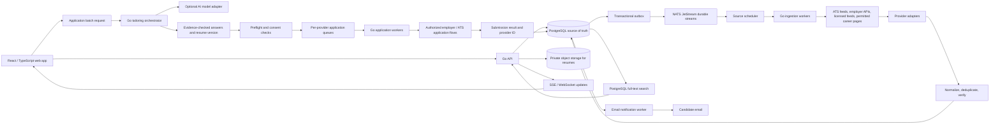

# OneRole global discovery and application architecture

**Prepared:** October 30, 2026  
**Backend base:** Go  
**Goal:** Index jobs from a large, authorized source registry; make recent listings visible quickly; and submit user-approved applications through employer flows that permit it.

## 1. Product and reliability boundaries

This should be designed for broad coverage, not advertised as literally covering every job worldwide. Employers may use private systems, unindexed pages, unsupported ATS products, or application flows that do not permit third-party submission. Every company and source needs a visible coverage and health state.

The product can target 500 application attempts in ten minutes for batches that pass preflight and have enough provider capacity. It cannot guarantee that every employer accepts all 500, that every external service responds within ten minutes, or that every employer sends a confirmation email. The reliability goal is **no silent loss, no duplicate application, and a known outcome for every selected job**.

Keep these events distinct:

- **Published time:** the date reported by the employer or provider.
- **First seen:** when OneRole first indexed the listing.
- **Last verified:** when the source most recently confirmed it was present.
- **Application accepted:** a provider or employer flow returned an authoritative submission identifier or status.
- **Employer email received:** a separate receipt that may or may not be sent.

The discovery service keeps checking an active job until the source confirms it is closed or no longer publishes it. When the user clicks **Apply**, move that job into **My Applications** immediately with a `Queued` or `Submitting` state, then update it only as the employer integration responds. Do not offer the same user/job pair for another submission while the result is pending or confirmed. **Pass** records a user-specific skip and removes the job from that user's active recommendations; it does not mark the employer's listing closed.

The normal interaction is one-click Apply for a single job. A bulk action can apply to a user-selected set (including 500) using the same per-job pipeline. A missing answer, sensitive question, required attestation, unsupported employer flow, or CAPTCHA should block only that job and explain why; the rest of the eligible batch continues. Never guess an answer or bypass an employer restriction.

## 2. System shape

Start with a Go modular monolith for APIs and domain logic, plus independently deployed worker processes. Split services only when measured load or ownership requires it.



### Recommended components

| Area | First production choice | Purpose |
|---|---|---|
| UI | React + TypeScript; use the existing prototype to settle interaction design | Search, job review, profile, batch preflight, progress, and applications |
| HTTP API | Go `net/http` with a small routing layer | Authenticated API, job search, profile, preferences, application state |
| Persistence | PostgreSQL | Company/source registry, canonical jobs, profiles, application batches and attempts |
| Text search | PostgreSQL `tsvector` + GIN initially | Search titles, descriptions, skills, companies, and locations; add a dedicated engine only after measurement |
| Tailoring | Go orchestration + optional model adapter + deterministic validation | Draft role-specific answers/resume versions from reviewed profile facts and preserve evidence links |
| Queue | NATS JetStream with durable consumers | Source sync and application work; consumers must expect redelivery |
| Resume files | S3-compatible private object storage | Encrypted resumes and application attachments; short-lived scoped upload/download links |
| Cache / limits | Redis if needed | Search cache and distributed token buckets; not the source of truth |
| Email | Transactional email provider | OneRole receipt after a confirmed submission and product notifications |
| Observability | OpenTelemetry traces, structured logs, metrics, alerts | Follow a source sync or one application across API, queue, worker, and provider |

PostgreSQL is a reasonable first search engine for a job index in the hundreds of thousands or low millions, subject to real workload testing. Its documentation recommends GIN as the preferred text-search index type for regular full-text queries. [PostgreSQL full-text search indexes](https://www.postgresql.org/docs/current/textsearch-indexes.html)

JetStream provides durable consumer state and at-least-once redelivery. A worker can see a message again after a timeout, so queue delivery alone does not provide exactly-once external application submission. [NATS JetStream consumers](https://docs.nats.io/nats-concepts/jetstream/consumers)

## 3. Discovering and maintaining 100,000+ company sources

### 3.1 Build a company/source registry

The unit of scheduled work is a **source instance**, not just a company. A large employer may have more than one board, region, or ATS account.

Maintain:

- `companies`: normalized company identity, official domain, display name, and career-site URL.
- `job_sources`: provider type, board token/site slug/company identifier, public base URL, allowed capabilities, credential reference, schedule, quota, status, and coverage note.
- `source_sync_runs`: start/end time, response status, jobs seen/changed/closed, retry count, and error summary.
- `source_cursors`: pagination or incremental-sync cursor, where the provider supports one.
- `source_observations`: source-specific external IDs, canonical URLs, raw timestamps, and last-seen evidence.

Populate the registry from a mix of licensed employer/source datasets, official ATS/customer integrations, company career URLs, vetted submissions, and partner feeds. Detect known ATS patterns from official career pages and structured metadata. Google documents the `JobPosting` structured-data format, including properties such as `datePosted` and `validThrough`; treat this as an enrichment/discovery path, not a complete global feed. [Google JobPosting structured data](https://developers.google.com/search/docs/appearance/structured-data/job-posting)

Do not assume there is a single public directory of all employers on every ATS. For example, Greenhouse's public job-board GET endpoint is keyed by a board token, while Lever's postings are namespaced by a site name. [Greenhouse Job Board API](https://docs.greenhouse.io/job-board), [Lever Postings API](https://github.com/lever/postings-api)

### 3.2 Source onboarding pipeline

1. Resolve the company's official domain and career URL from an authorized catalog or verified submission.
2. Detect a supported ATS using known hostnames, page metadata, canonical links, and board patterns.
3. Store the exact provider account/board identifier and supported operations.
4. Run a small validation sync; check pagination, locations, timestamps, descriptions, and application URLs.
5. Add the source to a quota-aware scheduler only after validation.
6. Track source health and freshness; pause a broken source without interrupting other sources.

Keep discovery and application capabilities separate. A source may support **listing only**, **listing plus hosted application link**, or **authorized API submission**. Never infer submission access from a public job-listing endpoint.

### 3.3 Polling and “last-minute” jobs

Use push events where a provider or employer offers an authorized webhook/feed. For pull-only sources, use tiered polling. Example starting policy—tune every interval to provider documentation, traffic, and observed freshness:

| Tier | Example interval | Examples |
|---|---:|---|
| Event-driven | Push on provider event | Webhook or licensed change feed |
| Hot | 2–5 minutes where permitted | Sources watched by users or with reliable change signals |
| Normal | 15–60 minutes | Enabled ATS sources with stable public feeds |
| Cold / low-signal | Several hours to daily | Pages that change rarely or have restrictive quotas |

At 100,000 sources, a one-request-per-source scan every five minutes is already about **600,000 requests/hour (14.4 million/day)** before pagination or job-detail fetches. A one-minute scan is about **72 million requests/day**. That is why a single “poll the whole world every minute” loop is the wrong design. Use push updates, incremental cursors, conditional requests, adaptive schedules, per-provider token buckets, and prioritization.

When a newly verified listing is indexed, publish a lightweight update through Server-Sent Events or WebSockets to the user's active feed. Define “last minute” as **first seen by OneRole in the last minute**, and display the employer's publication time separately. The source may publish or expose a new job later than the actual moment the employer created it, so end-to-end instant discovery cannot be promised.

For recent listings, query from stored jobs by `posted_at` when the source provides a reliable timestamp. Also keep `first_seen_at`, `last_seen_at`, `last_verified_at`, `closed_at`, and `source_updated_at`. If `posted_at` is missing, show “First discovered …”; do not relabel discovery time as publication time. Keep at least 60 days of observed history. A job removed before OneRole ever observed it can only be recovered from a licensed archive or another authorized historical source.

### 3.4 Normalize and deduplicate

Use a canonical job identity from provider + external job ID first, then canonical URL, then a controlled similarity fallback (company, normalized title, location, requisition ID). Keep all provider observations behind one canonical job. Store original titles, raw descriptions, source attribution, and source timestamps alongside normalized fields. Never overwrite the source's original values with guessed salary, location, or publication time.

## 4. Application submission architecture

### 4.1 Provider capability matrix

The official API docs show that listing access and application submission are different permissions and products:

| Provider | Discovery | Application submission boundary |
|---|---|---|
| Greenhouse | Public job-board GET endpoints expose published jobs | Submission endpoint uses Basic Auth with a job-board API key; the API expects a job-specific form. Greenhouse also warns that required-field validation is the custom form's responsibility. |
| Lever | Public postings API supports per-site listings and detail | Programmatic apply needs a site API key. Lever documents a limit of 2 application POSTs/second and asks custom sites to queue/retry `429` responses. |
| Ashby | Job-board endpoints expose postings and application-form definitions for a custom careers flow | `applicationForm.submit` requires `candidatesWrite`; it is not a universal anonymous job-board submit endpoint. |
| SmartRecruiters | Posting API exposes published postings | Application API is protected; OAuth integration requires `candidate_applications_manage`. It has adaptive throttling and documents an 8-concurrent-call limit. |
| Workable | Careers-page API exposes open jobs for an account | Creating candidates requires the account's `w_candidates` scope. The documented general API limit is 10 requests per 10 seconds. |

Sources: [Greenhouse Job Board API](https://docs.greenhouse.io/job-board), [Lever Postings API](https://github.com/lever/postings-api), [Ashby custom careers page flow](https://developers.ashbyhq.com/docs/creating-a-custom-careers-page), [Ashby application submit endpoint](https://developers.ashbyhq.com/reference/applicationformsubmit), [SmartRecruiters Application API](https://developers.smartrecruiters.com/docs/application-api), [Workable candidate creation](https://workable.readme.io/reference/job-candidates-create), [Workable API limits](https://help.workable.com/hc/en-us/articles/115013356548-Workable-API-Documentation).

These APIs are designed around employer/customer career sites or authorized integrations. To submit for arbitrary companies, OneRole needs the employer/provider's approved integration path and credentials, or it must hand off to the employer's hosted application page. A public listing API alone does not grant permission to submit candidates.

### 4.2 Job-specific resume and answer tailoring

Add an opt-in **Tailor my application** capability to the user-approved Apply flow. It produces two related artifacts: (1) concise answers for the employer's actual form questions, and (2) a role-specific resume version that brings the most relevant verified experience forward. Keep question-and-answer content in the form fields; use relevant evidence to reorder or clarify resume sections rather than pasting a questionnaire into the resume.

Use a claim-grounded pipeline:

1. Parse the user's uploaded resume and profile into structured facts such as role, employer, dates, skills, project summaries, and user-provided outcomes. Keep a pointer to the source span or profile field for each fact, plus whether the user reviewed it.
2. Read the employer's form schema and job description. Classify each question (experience, work authorization, availability, compensation, demographic, legal attestation, free text) and its required/optional status.
3. Ask the tailoring service for structured drafts using only the user's reviewed facts and the job context. Each sentence or answer must return the fact IDs that support it. Job-description language may guide emphasis and vocabulary, but must not be treated as evidence about the candidate.
4. Validate every factual clause against those fact IDs. Reject unsupported employers, dates, degrees, certifications, technologies, metrics, responsibilities, or outcomes. If facts are missing or contradictory, mark that answer `needs_user_input`; do not fill it with a guess.
5. Build a separate, versioned resume artifact that preserves the original facts while changing emphasis, ordering, and concise wording. Store a hash and the exact resume/answer versions attached to this application.
6. If the user enabled automatic tailoring and the content only uses previously reviewed facts, attach the generated packet during Apply. New claims, ambiguous facts, sensitive questions, and legal attestations wait for the user on that application only. Allow the user to preview, edit, approve, or disable future tailoring.

“Strongest applicant” should mean clear, relevant, readable presentation of the candidate's real experience. It cannot mean adding qualifications or promising a hiring outcome. Keep explicit user control over profile facts, optional external AI processing, retention, and deletion. Never infer demographic or other sensitive answers from a resume. For high-volume apply, the preapproved policy can submit evidence-validated experience answers automatically while other tasks in the batch continue.

Suggested data records: `resume_facts` (normalized fact, source location, review state), `tailoring_runs` (job/form version, model/config version, validation status), `tailored_resume_versions` (private object key, content hash, source resume version), and `application_answers` (question ID, draft/approved value, supporting fact IDs, review state). The application task references immutable resume and answer versions so the user can see exactly what was sent.

### 4.3 Batch apply flow

For a user selecting 500 listings, create one `application_batch` and 500 separate `application_tasks`. Before any network submission, run preflight on each task:

1. Listing is still active and recently verified.
2. This user has not already applied to this canonical job.
3. The source supports an authorized submission route.
4. The user's approved resume and profile are available.
5. Required fields and screening answers are mapped to approved answers or generated from reviewed, evidence-linked facts.
6. Employer privacy/consent choices and any required notices are ready for that destination.
7. The source-specific rate budget can accept the work.

Show preflight counts before the final batch action: **ready**, **needs an answer**, **requires one-time review**, **already applied/duplicate**, **closed/unverified**, and **unsupported submission route**. The user can submit the ready group and resolve blocked tasks separately. Never fill an unknown answer by guessing.

Use a per-application state machine such as:

```text
queued → preflight_passed → submitting → submitted_confirmed
                  ↘ needs_user_input
                  ↘ unsupported / closed / duplicate
                  ↘ retry_wait
                  ↘ submission_unknown → reconciled_success | reconciled_not_submitted
```

For each task, persist the user's batch consent, resume version, answer-set version, provider, canonical job ID, attempt ID, request metadata (excluding sensitive raw documents), provider response ID, and timestamps. Add a unique database constraint on `(user_id, canonical_job_id)` and a stable internal `submission_intent_id` before enqueueing.

Use a transactional outbox to commit the application record and queue event together. Workers enforce per-provider and per-account token buckets, concurrency, timeouts, and backpressure. Retry documented transient failures such as `429` or selected `5xx` responses with provider-aware exponential backoff and jitter. Route permanent validation failures to `needs_user_input` or a clear failure state.

If a POST times out after the provider may have accepted it, record `submission_unknown` and reconcile using the provider's application/status lookup or a verifiable receipt before retrying. Do **not** blindly resubmit: most external APIs cannot give OneRole universal exactly-once semantics.

### 4.4 What “500 in ten minutes” can mean

The raw target is `500 / 600 seconds = 0.83 submissions/second`. Go workers and a durable queue can handle that internal rate. The limiting factor is the external provider accounts, permissions, form complexity, and response latency.

The official provider limits show why a universal promise is impossible:

- Lever documents a 2 application-POSTs/second limit. A theoretical 500 sequential POSTs at that ceiling take 250 seconds before form preparation, network delay, throttling, or retries.
- Workable documents 10 API requests per 10 seconds. If each application took one request under one account-level budget, 500 requests alone would take at least 500 seconds, leaving little room for any additional calls.
- SmartRecruiters documents up to 8 concurrent calls and adaptive throttling, so latency can vary with platform load.

Actual quotas may be scoped per employer account, source, credential, or provider, and some are not public. Make no blanket “500 guaranteed” claim until each integration has a written quota and load-tested behavior. A reasonable SLO to validate is: **for preflight-ready applications on configured sources, 95% reach an authoritative terminal outcome within ten minutes at the agreed batch size**. The other 5% remain visible as retrying, unknown/reconciling, or needing user input—never counted as success.

The progress screen should show counts that add to 500: `queued`, `submitting`, `submitted/confirmed`, `needs your input`, `already applied`, `closed`, `unsupported`, `retrying`, and `unknown/reconciling`. A green “submitted” state requires an authoritative provider success result, not just a local button click or an HTTP request being sent.

## 5. Confirmation email behavior

Send an **OneRole confirmation email** only after the provider confirms the application. Include employer, role, time, source, and the status returned by the integration. Keep an `employer_receipt_status` separate from `submission_status`.

Employer-generated email behavior varies. Lever documents candidate email after apply unless its `silent` flag is used. Workable documents that API-created candidates are treated as “applied” and receive its thank-you email when `sourced:false`; otherwise they are treated as uploaded/sourced. These examples do not mean every employer sends a receipt. [Lever email behavior](https://github.com/lever/postings-api), [Workable candidate creation behavior](https://workable.readme.io/reference/job-candidates-create)

If OneRole should detect employer emails in a user's mailbox, make that a separate, optional, clearly scoped mailbox integration. Do not claim to have received an employer receipt unless the message was actually observed.

## 6. Go code organization and data model

Suggested starting tree:

```text
cmd/api/
cmd/ingest-worker/
cmd/application-worker/
cmd/notification-worker/
internal/auth/
internal/company/
internal/source/
internal/job/
internal/search/
internal/matching/
internal/application/
internal/provider/{greenhouse,lever,ashby,smartrecruiters,workable}/
internal/queue/
internal/storage/
internal/notification/
internal/audit/
db/migrations/
```

Keep `context.Context` in Go request/worker/database calls so deadlines and cancellations propagate to long-running work. Go's database guidance describes `QueryContext` and cancellation for operations whose caller is gone or whose deadline has elapsed. [Go database cancellation](https://go.dev/doc/database/cancel-operations)

Core tables:

- `companies`, `job_sources`, `source_sync_runs`, `source_cursors`
- `jobs`, `job_source_observations`, `job_status_history`
- `users`, `profiles`, `resumes`, `resume_extracted_data`, `user_job_preferences`, `approved_answers`
- `application_batches`, `application_tasks`, `application_attempts`, `application_receipts`
- `notifications`, `notification_deliveries`, `audit_logs`, `outbox_events`

Use private object storage and encrypted transport/storage for resumes. Keep provider credentials in a secret manager; in PostgreSQL store only a secret reference. Add owner-scoped authorization for resumes, profiles, and applications. Audit every application batch consent and every submission attempt. The frontend must never receive employer integration keys.

## 7. Operating the 100,000-source system

Monitor these signals separately:

- active company/source count and coverage by source type and country
- source freshness p50/p95, last successful sync, per-source consecutive failures
- due queue depth and oldest task age
- provider `429`, `5xx`, timeout, schema-change, and parse-rejection counts
- newly discovered, updated, deduplicated, closed, and uncertain listings
- application batch queue age, provider concurrency, submitted-confirmed rate, unknown status count, and duplicate prevention count
- email delivery status and employer receipt status

Use circuit breakers and source-level backoff so one provider failure does not stop unrelated feeds. For job closure, require repeated or authoritative evidence; one failed fetch is not proof that the employer removed the job.

## 8. Rollout plan

1. **Design/API contract:** Agree on “first seen,” “posted,” “submitted,” “confirmed,” and “employer receipt.” Build a provider capability matrix before promising auto-apply.
2. **Local vertical slice:** Go API + PostgreSQL + one queue + explicit demo fixtures; search, profile/preferences, saved jobs, application tracker. Keep all demo jobs labeled.
3. **Discovery pilot:** Integrate 1–2 permitted ATS feeds; measure source freshness, job normalization, duplicate rate, and closure evidence. Add company-source registry and admin health view.
4. **Submission pilot:** Work with a consenting employer/customer or approved ATS partner; submit only through its authorized endpoint. Validate question mapping, provider success signals, email behavior, and reconciliation.
5. **Batch application:** Add preflight, 50-job load tests, then 500-job runs against sandbox/authorized tenants. Tune provider-specific rate budgets from actual quotas and latency.
6. **Scale coverage:** Expand the source registry to thousands, then 100,000+ only as source permissions, provider quotas, crawler policy, and operational cost are understood. Use staged polling tiers and licensed data where it materially improves coverage.
7. **Production:** Separate staging credentials, run migrations with rollback plans, deploy workers independently, enforce secret management, private resume storage, backups, audit retention, and freshness/application SLO alerts.

## 9. Local-first development and production promotion

Build and review the whole user journey locally before connecting any real employer account. A practical local environment is Docker Compose with the Go API/workers, PostgreSQL, NATS JetStream, an S3-compatible local object store, and a local email catcher. Use labeled fixture jobs, a deterministic tailoring fixture with evidence links, and fake ATS adapters that can return success, validation errors, throttling, timeouts, duplicate results, and ambiguous outcomes. Local Apply should only create simulated submissions; it must not have production credentials, call an external model with personal data, or submit real applications.

Keep the provider interface stable across environments (`ListJobs`, `GetApplicationForm`, `SubmitApplication`, and `GetSubmissionStatus` where the provider supports them). The local fake adapter and production adapter share the same domain contract. Promote in stages: local fixtures → provider sandbox or consenting test tenant → staging with isolated credentials and allowlisted test jobs → production after source permissions, rate limits, privacy handling, reconciliation, and rollback procedures are verified. A feature flag and environment-level credential separation should make accidental live submission from a developer machine impossible.

The local prototype can use seeded data to review the layout and interaction. Label all sample listings, dates, freshness, and submission states as illustrative until connected to a real source. A prototype “Apply” should visibly simulate the queue and receipt path without implying an employer received an application.

## 10. UX review checklist

- Discovery has **Last 60 days**, **Recently discovered**, and filters for country/location, remote, role, source, and freshness.
- Each listing distinguishes employer `posted_at` from OneRole `first_seen_at` and `last_verified_at`.
- Apply immediately moves the card into **My Applications** with `Queued`/`Submitting`, then shows confirmed or an actionable blocked/retrying/unknown status.
- Pass removes the item from the user's active queue and allows undo; it does not affect other users or the employer listing.
- A batch can continue when individual applications need attention. Progress totals reconcile to the selected count, and only authoritative provider success is labeled submitted.
- The employer's listing remains monitored until verified closed, while the user's already-applied record remains in application history.

## 11. Source references

- [Greenhouse Job Board API](https://docs.greenhouse.io/job-board)
- [Lever Postings API](https://github.com/lever/postings-api)
- [Ashby: Creating a custom careers page](https://developers.ashbyhq.com/docs/creating-a-custom-careers-page)
- [Ashby: applicationForm.submit](https://developers.ashbyhq.com/reference/applicationformsubmit)
- [SmartRecruiters Application API](https://developers.smartrecruiters.com/docs/application-api)
- [SmartRecruiters: Post an Application](https://developers.smartrecruiters.com/docs/partners-post-an-application)
- [Workable: create candidate](https://workable.readme.io/reference/job-candidates-create)
- [Workable: custom careers page API and scopes](https://help.workable.com/hc/en-us/articles/115012771647-Using-the-Workable-API-to-create-a-careers-page)
- [Workable API documentation and rate limit](https://help.workable.com/hc/en-us/articles/115013356548-Workable-API-Documentation)
- [Google JobPosting structured data](https://developers.google.com/search/docs/appearance/structured-data/job-posting)
- [Go database cancellation](https://go.dev/doc/database/cancel-operations)
- [PostgreSQL text-search indexes](https://www.postgresql.org/docs/current/textsearch-indexes.html)
- [NATS JetStream consumers](https://docs.nats.io/nats-concepts/jetstream/consumers)
- [Temporal Go SDK](https://docs.temporal.io/develop/go)
