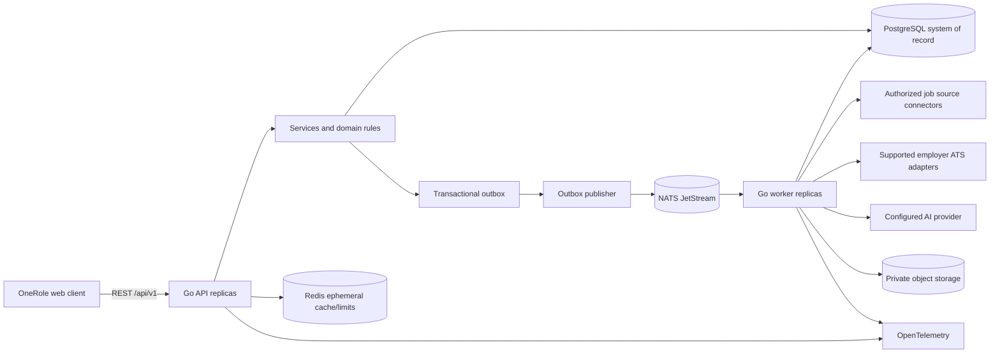
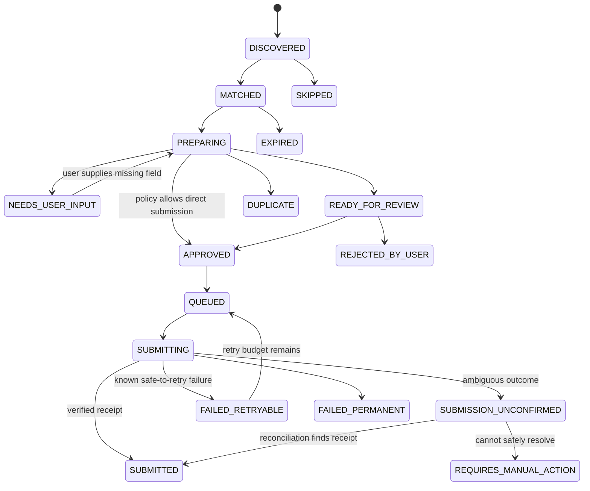

# OneRole backend architecture

**Status:** design proposal for review. This is not evidence of an implemented or production-ready service.

## 1. What the backend must do

OneRole discovers jobs from authorized sources, normalizes and searches them, matches them to a user's verified profile, prepares an evidence-backed application packet, and tracks an application through an authorized employer flow. The platform is multi-tenant, with global job catalog data separated from tenant-owned resumes, answers, consent, and application history.

The backend is designed for high workflow-request throughput and independently scalable ingestion and application workers. It does not promise that all jobs worldwide are discoverable, that every employer permits automated applications, or that every employer will accept an application within a fixed time.

## 2. Decisions and constraints

| Area | Initial design | Why |
|---|---|---|
| Application shape | One Go modular monolith; root `main.go` only | Shared domain and transactions stay simple while API and worker replicas scale separately. |
| Runtime modes | `APP_MODE=api`, `worker`, or `all`; explicit `go run . migrate` command | Same binary for local development and production roles; migrations do not run on every API startup. |
| HTTP | REST/JSON under `/api/v1`, documented in OpenAPI | Clear browser/client contract and straightforward request idempotency. |
| System of record | PostgreSQL | Durable relational state, transactional outbox, constraints, tenant-scoped queries, and initial full-text search. |
| Queue | NATS JetStream | Durable streams and acknowledged consumers suit asynchronous workflows without starting with Kafka-level operational complexity. Delivery is at least once, so consumers must be idempotent. |
| Cache | Redis for short-lived counters, rate limits, and hot cache only | Durable application and submission state remains in PostgreSQL. Redis failure must not erase a submission. |
| Search | PostgreSQL full-text search plus `pg_trgm` initially | Fewer moving parts for the first vertical slices. Add OpenSearch only after query relevance, faceting, or measured load requires it. |
| Documents | Private object-storage interface; local S3-compatible service and production S3-compatible storage | Resume originals and derived files are not stored as public URLs or large database blobs. |
| Observability | OpenTelemetry traces, structured logs, Prometheus-compatible metrics | Trace a user Apply action through the API, outbox, queue, adapter, and receipt. |

Technology choices are recorded in [ADR-0001](../adr/0001-backend-foundation.md). The initial queue choice is an architectural starting point, not a capacity claim.

## 3. System view



The API persists the intent and an outbox event in one PostgreSQL transaction. A publisher sends committed events to JetStream and marks them delivered. Workers receive at-least-once messages, claim work, enforce domain transitions, persist the result, and acknowledge only after durable completion. Duplicate messages are expected and safe by design.

Queue messages contain identifiers and bounded metadata, not resume contents, access tokens, or full application answers. A worker reloads tenant-owned data through tenant-scoped repositories.

## 4. Go package boundaries

Follow the simplified architecture document: top-level packages, no nested `cmd/*/main.go`, and exactly one `main.go` at repository root. Do not create empty packages just to match a tree.

```text
oneRole/
├── main.go                 # configuration, dependency graph, runtime and shutdown
├── config/                 # typed config and startup validation
├── controller/             # HTTP request/response handlers only
├── middleware/             # auth, active tenant, request ID, limits, recovery
├── service/                # use cases, authorization checks, state transitions
├── models/                 # domain entities/value types; no transport/vendor models
├── repository/             # focused interfaces and PostgreSQL implementations
├── db/                     # pool, migrations, transactions
├── worker/                 # bounded asynchronous consumers and schedulers
├── connectors/             # job, ATS, AI, parser and storage adapters
├── queue/                  # JetStream publisher/consumer abstraction
├── search/                 # search interface; PostgreSQL implementation first
├── observability/          # tracing, metrics, health/readiness
├── utils/                  # small technical helpers only
├── api/openapi.yaml
├── migrations/
├── tests/                  # unit, integration, contract, security and load tests
└── docs/
```

Dependency direction is `controller → service → repository → db`. Services depend on focused interfaces for repositories and connectors. Workers invoke the same services/domain rules as HTTP requests; they do not create a second implementation of business logic. Domain models do not import HTTP, PostgreSQL, queue, or vendor SDK packages.

### Root entry point lifecycle

`main.go` loads and validates typed configuration, initializes logging/telemetry, opens and pings dependencies, constructs repositories/services/controllers/workers, starts the selected runtime, listens for termination, and performs bounded graceful shutdown. It contains no database queries or business workflows.

- `APP_MODE=api`: HTTP server and API health/readiness routes.
- `APP_MODE=worker`: queue consumers and scheduled work.
- `APP_MODE=all`: both roles for local use.
- `go run . migrate`: explicit migration operation through the same entry point; production deploys run it as a controlled release step.

API and worker containers use the same image but different runtime modes, allowing independent replica counts and resource limits.

## 5. Domain boundaries

### Identity and tenancy

Users authenticate through a replaceable identity provider/session boundary. A validated identity is mapped to a user and tenant membership. The active tenant is resolved from that membership on every request; a client-supplied tenant ID is never trusted by itself. Roles initially include `owner`, `admin`, and `member`, with authorization rules defined per use case.

### JWT authentication and social login

The OneRole application presents “Continue with Google” and “Continue with GitHub” sign-in actions. Each starts a backend-owned OAuth authorization-code flow; provider credentials and tokens are never handled by the UI as OneRole API credentials.

- Bind each login attempt to the browser using one-time random state, a PKCE S256 verifier/challenge, a short expiry, and a fixed allowlisted return path. Use exact registered callback URLs. For Google, also use OIDC nonce and validate the ID token signature, issuer, audience, expiry, nonce, and verified-email claim. For GitHub, exchange the one-time code server-side and fetch the authenticated provider subject plus only the email information needed for login. Do not request repository access.
- Store provider identity by stable provider subject, not display name or email. If GitHub returns no verified email, preserve the provider identity and require a verified OneRole contact email before email-dependent features. Never auto-link accounts merely because provider email strings match; linking requires an authenticated session and proof of control of the second provider.
- After provider verification, issue a OneRole-signed short-lived JWT access token. Do not reuse a Google or GitHub access/ID token as the OneRole bearer token. Include only issuer, audience, subject, issued/expiry times, token ID, key ID, and session ID; derive current tenant membership and permissions from OneRole authorization data rather than trusting stale role claims.
- Sign with an asymmetric key held in a production key manager, validate a fixed algorithm allowlist, reject unsigned/algorithm-confused tokens, and rotate keys with key IDs while retaining a bounded previous verification key set. Enforce issuer, audience, expiry, not-before, and token type on every API request.
- Keep access tokens in browser memory rather than local storage. Use a Secure, HttpOnly, SameSite refresh cookie, rotate opaque refresh tokens on every use, store only hashes, detect reuse, and revoke the token family/session on replay. Protect refresh/logout cookie routes with same-site policy, Origin checks and CSRF protection. Revoke sessions on logout and account security events; keep access-token lifetime short to bound revocation delay.
- Apply authentication middleware before tenant resolution and authorization. Rate-limit OAuth start/callback, refresh, and sensitive account endpoints. Redact all codes, tokens, cookies, and provider responses from logs.

JWT access proves the caller's OneRole identity. It does not authorize a tenant resource by itself: services still check membership, role, ownership, and current policy for every protected operation.


Provider client IDs/secrets, exact callback URLs, JWT issuer/audience, signing-key reference, access lifetime, refresh limits, and allowed frontend origins belong in typed configuration. Local secrets stay in an ignored .env file; the checked-in example contains placeholders only. Production signing keys and provider secrets come from a secret/key manager. Startup fails closed for a required but incomplete provider configuration, and the UI only shows a provider as enabled when its server configuration is valid.

Authentication implementation checks must cover state/PKCE/nonce mismatch and replay, invalid or wrong-audience Google ID tokens, GitHub callback denial and missing/unverified email, expired or wrong-audience OneRole JWTs, invalid signing keys, refresh-token rotation and reuse, logout revocation, account-link ownership, and tenant-role changes.

### Job discovery

A source registry identifies a company, source type, public/configured endpoint, allowed capabilities, polling policy, rate limits, and health. Each connector implements a common interface for capability discovery, incremental sync, normalization, checkpointing, health, and error classification. Source onboarding is explicit and allowlisted.

Job discovery and application submission are independent capabilities. A source can provide readable listings but no supported application submission. The UI and API expose that distinction.

A normalized job is global catalog data where source terms permit sharing. Source observations retain the source ID, external ID, original URL, timestamps, and payload provenance. Deterministic source IDs and canonical URLs drive deduplication; fuzzy title similarity alone never merges records across employers.

### Resume and application preparation

Original resumes are immutable private objects. Parsing creates versioned structured facts with evidence references (file version, page/section or user-confirmed profile field). Tailored resumes and answers are derived artifacts, never overwrites of the original.

Every generated factual answer carries evidence IDs and validation status. Job requirements are not evidence that the applicant has a skill. Missing or ambiguous facts become a pending question. Sensitive information, legal declarations, and employer attestations require explicit user-supplied data and the review policy configured for that field. AI output cannot mark itself validated.

### Applications and submission

An application is a tenant-owned workflow instance for one user and one job. A user clicking Apply records the explicit action and initiates preparation/submission according to the selected policy. If a packet is already valid, the employer flow is supported, and consent covers it, the same action can enqueue submission immediately. If information is missing, an attestation needs review, or the employer flow is unsupported, that application pauses with a precise reason; other batch items continue.

No adapter bypasses authentication, CAPTCHA, MFA, employer restrictions, or anti-automation controls. A successful network call alone is not proof of application submission. `SUBMITTED` requires sufficient receipt evidence; ambiguous responses move to `SUBMISSION_UNCONFIRMED` and reconciliation, never blind resubmission.

## 6. Job freshness and source coverage

The job record keeps separate clocks:

- `published_at`: employer/source publication timestamp, nullable if unknown.
- `first_seen_at`: first time OneRole observed the listing.
- `last_seen_at`: most recent successful observation.
- `source_updated_at`: source-provided modification time, nullable.

Never backfill an unknown employer publication time with ingestion time. Date-window filters use published_at only when known; first_seen_at is a separate filter, and listings with unknown publication time are exposed in an explicit unknown-date bucket. Search results sort deterministically and use cursor pagination.

“Last-minute” freshness is source-dependent. Use source webhooks when officially offered; otherwise poll within published rate limits and a connector-specific schedule. Surface source last-sync time and observed ingestion lag. Absence from one response does not immediately prove a vacancy is closed; closure requires source evidence or a documented number/time of missed observations.

### Working job filters

The screenshot's search and filters are backend-backed query fields, not decorative controls. The UI keeps draft selections locally; clicking Apply sends one combined search request and refreshes results plus facet counts. Clear resets all selections and returns to the default query. Multi-select values within one facet use OR; different facets combine with AND; exclusion rules remove matching results.

The filter contract is:

| UI control | Normalized data and query behavior |
|---|---|
| Search by title or keyword | Full-text match across title, role aliases, skills, employer name, and description; rank exact title/role matches above description matches. |
| Exclude / hide jobs mentioning | Case-insensitive excluded terms/phrases across title, employer, description, responsibilities, and qualifications. A result is removed if it matches any excluded term. |
| Date | Presets: last 24 hours, 7 days, 30 days, 60 days, custom, and any time. Use source publication time for published-date filters. A separate first-seen filter handles newly discovered listings. Unknown publication dates remain an explicit selectable bucket rather than being silently assigned an ingestion date. |
| Location | Multi-location country/region/city or normalized location IDs, optional radius in km, and explicit unknown-location bucket. Multiple selected locations are ORed. |
| Workplace | Remote, hybrid, on-site, and unknown; this is distinct from city/country. |
| Companies | Include selected normalized company IDs and optionally exclude selected company IDs. A company name maps to its canonical company ID, not text substring matching. |
| Degree level | High school, associate, bachelor, master, doctorate, no degree stated, and unknown. Preserve required vs preferred; the UI can select either or both. |
| Max experience | Numeric maximum for explicitly stated experience requirement ranges. Keep min and max separately; “5+ years” has no known upper bound and belongs in the open-ended/unknown bucket. Do not invent an upper bound from job title or seniority. |
| Sponsors visa | Sponsorship yes, no, or unknown. Set yes/no only from source text or verified employer data with provenance; otherwise unknown. |
| Role | Canonical role family/role IDs with synonym mapping, such as Backend Engineer or Product Manager. |
| Job Type | Career level/opportunity level: internship, entry level, associate, mid level, senior, lead, manager, director, executive. |
| Employment Type | Full time, part time, contract, temporary, seasonal, freelance, internship, apprenticeship, or other when explicitly identified. |

The search response includes the applied filter values, result cursor, and current facet counts split into known values and unknown/unclassified values. A filter selection must not silently erase listings merely because an enrichment field is missing: each facet exposes its unknown count and the user can choose whether to include unknowns. Derived degree, experience, visa, role, and job-type values retain source evidence, confidence, and taxonomy version. Search indexes are updated asynchronously from the normalized database record and are rebuildable.

A goal of 100,000 companies requires a company/source registry and multiple authorized acquisition channels. It is not achieved by crawling 100,000 websites indiscriminately. Coverage reports the number of active companies and sources, supported regions, source capability, last success/error, sync lag, and listing counts. Licensed feeds and employer partnerships can complement public ATS endpoints. No “all jobs live” claim is made.

## 7. Application state machine



The service layer owns the allowed transitions and writes an append-only application event in the same transaction as each state change. Clients cannot PATCH an arbitrary status. A cancellation is accepted only before the connector's irreversible submission boundary; after that it becomes a reconciliation/support action.

## 8. Batch throughput and the 500-in-10-minutes request

The system target is to accept and enqueue up to 10,000 workflow requests per minute (about 167 per second), then prove achieved throughput with load tests. That is not a promise of 10,000 external submissions per minute. A user-selected batch of 500 can be accepted quickly and return a batch ID, but each item proceeds independently through validation, queueing, adapter-specific rate limits, and employer response handling.

The design uses:

- Stateless API replicas and separate worker pools per workload.
- PostgreSQL connection pooling and bounded transactions.
- Transactional outbox plus durable queue.
- Bounded worker concurrency, per-tenant fairness, per-connector token buckets, admission control and backpressure.
- Idempotency keys for API requests, unique application constraints, and durable consumer inbox/deduplication records.
- Retry budgets with exponential backoff and jitter for errors known to be safe to retry.
- Dead-letter handling and operator-visible failure reasons.
- A batch record with per-item status and counts, not a single all-or-nothing transaction.

An idempotency key prevents a repeated OneRole request from creating a second workflow. It cannot guarantee exactly-once effects at an employer that offers no idempotency contract. For an ambiguous employer response, OneRole reconciles before retrying. Actual submission rate is bounded by the employer/ATS, account access, policy, and supported adapter. The platform will report accurate per-item outcomes instead of promising zero errors or guaranteed employer acceptance.

The employer controls its confirmation email. OneRole records an ATS receipt/confirmation identifier when available; a connected mailbox can be a separate, explicitly authorized reconciliation signal. OneRole cannot force an employer to send an email.

## 9. Tenancy, privacy, and security

- Put `tenant_id` on every user-owned row and include it in foreign keys and tenant-scoped unique constraints.
- Global job catalog tables are explicitly documented as global; resume facts, packets, answers, applications, consents, and audit events are tenant-scoped.
- Repository methods require tenant context. Begin a transaction, resolve membership, then set a transaction-local PostgreSQL tenant variable. Do not set session-wide tenant state on pooled connections.
- Add PostgreSQL RLS as defense in depth for tenant-owned tables. Use a restricted runtime role; ensure table-owner bypass is handled deliberately and test policies with the actual runtime role.
- Do not log resume text, answers, tokens, email contents, or signed URLs. Redact PII from traces and connector errors.
- Validate uploads by size and format, scan when available, store privately, encrypt at rest, and use short-lived signed URLs.
- Treat resumes, job descriptions, and employer forms as untrusted prompt-injection content. AI tools receive only scoped data and cannot invoke connectors or bypass policy.
- Support data export, deletion, retention rules, credential revocation, and auditable consent/policy changes.
### JWT and account security

JWT validation is shared middleware, not controller-specific code. The access token is short-lived and audience-bound to the OneRole API; refresh is stateful, rotated, revocable, and stored hashed. OAuth provider access tokens are discarded after identity resolution unless a separately consented feature needs them. Google and GitHub identities are keyed by immutable provider subject; account linking is explicit. Tenant roles are checked against current membership data on protected operations.

- Protect URL-fetching connectors against SSRF: allowlisted hosts, DNS/IP validation, redirect limits, response caps, and strict timeouts.

## 10. API behavior and error model

Public routes use `/api/v1`. See the API contract and [OpenAPI draft](../../api/openapi.yaml). Tenant context is resolved from authenticated identity and membership, not trusted from a free-form body field.

Long work returns `202 Accepted` with a durable workflow or batch ID. Synchronous API handlers only validate, authorize, persist intent, and publish through the outbox. The standard error envelope is:

```json
{
  "error": {
    "code": "APPLICATION_NEEDS_USER_INPUT",
    "message": "A required application answer needs your review.",
    "request_id": "req_...",
    "details": [{ "field": "work_authorization", "reason": "not_provided" }]
  }
}
```

Errors are stable machine-readable codes; messages are safe and do not disclose another tenant's data or connector secrets. Use cursor pagination with bounded limits for jobs, applications, and events. Require `Idempotency-Key` on consequential create/submit/batch operations.

## 11. Local-first to production

### Local design environment

A Docker Compose profile will run PostgreSQL, Redis, NATS with JetStream enabled, and a private S3-compatible object store. The Go binary runs in `all` mode for convenience, while API and worker profiles use the same image in their own modes. Migrations are explicit. Local credentials are disposable and never production credentials.

Use connector contract fixtures for unit/integration tests. A manually enabled read-only sync may call a documented public source; mark imported data with its real source and sync timestamps. Keep employer submission disabled locally unless using an authorized test/sandbox employer flow. Do not treat fixtures as live job discovery.

### Production path

1. Deploy a staging environment with managed PostgreSQL, private object storage, secrets manager, OIDC/session provider, queue, cache and telemetry.
2. Run schema migrations as a controlled release step using expand/migrate/contract changes; test backup restore and rollbacks.
3. Enable one read-only job connector at a time; monitor coverage and rate-limit behavior.
4. Add packet preparation with evidence validation and user confirmation.
5. Enable submission only for a verified adapter, an explicit consent scope, and a controlled employer test account where available.
6. Canary production traffic, monitor per-source submission outcomes and pause the connector on regressions.
7. Scale API on latency/request rate and workers on queue age/depth with per-tenant and per-source caps. Add OpenSearch only after measured search needs justify it.

Production can deploy one image as API and worker roles on a managed container platform. Kubernetes/Helm remain a later deployment option if the team's operational needs justify them; they are not required to develop locally. Never run migrations automatically on every API replica.

## 12. Service-level measures to define before launch

Set numeric SLOs only after baseline measurements. Required measures include API acceptance latency, outbox age, queue wait time, ingestion lag by connector, source error rate, stale/closed-job reconciliation lag, packet preparation latency, submission evidence rate, ambiguous-outcome rate, duplicate-prevention rate, tenant isolation failures, and deletion completion time.

The 10,000 workflow-request/minute target needs repeatable load tests at 100, 1,000, 5,000, and 10,000/minute plus burst, queue recovery, slow ATS, AI throttling, worker restart, and duplicate delivery scenarios. Record accepted requests separately from successfully processed workflows and externally confirmed applications.

## 13. Open decisions before implementation

- Google/GitHub OAuth app registration, exact production callbacks, signing-key management, verified-email and account-recovery policy.
- First production region and data residency requirements.
- Initial job-source acquisition agreements and exact supported regions.
- First employer submission adapter with a documented test environment.
- Resume parser and AI providers, model retention terms, and per-tenant cost limits.
- Production queue hosting and disaster-recovery objectives.
- Retention periods for resumes, packets, audit trails, and external receipts.
- Numeric latency, availability, and freshness SLOs.

These decisions can be resolved without changing the core boundaries above.
